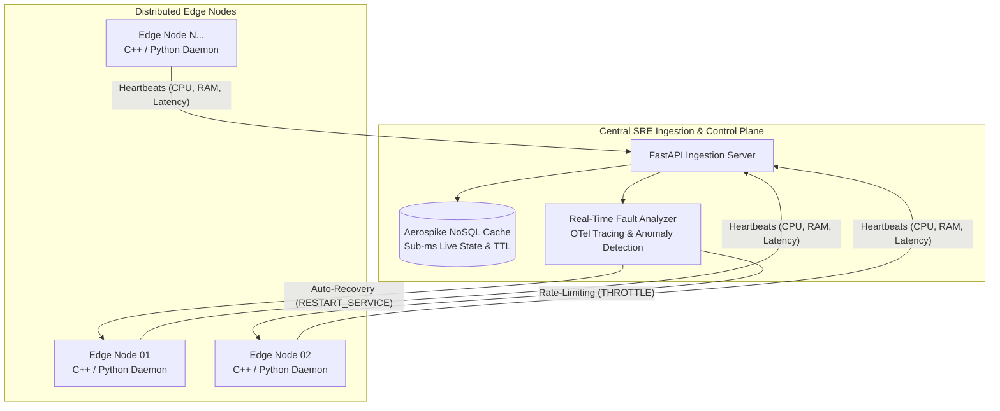

# Distributed Edge Fleet SRE & Telemetry Platform

&lt;p align=&quot;left&quot;&gt;
  &lt;img src=&quot;https://img.shields.io/badge/Python-3.11_%7C_3.12_%7C_3.13-3776AB?logo=python&amp;logoColor=white&quot; alt=&quot;Python&quot; /&gt;
  &lt;img src=&quot;https://img.shields.io/badge/C++-17-00599C?logo=c%2B%2B&amp;logoColor=white&quot; alt=&quot;C++&quot; /&gt;
  &lt;img src=&quot;https://img.shields.io/badge/Docker-Containerized-2496ED?logo=docker&amp;logoColor=white&quot; alt=&quot;Docker&quot; /&gt;
  &lt;img src=&quot;https://img.shields.io/badge/Aerospike-NoSQL_Cache-EE0000&quot; alt=&quot;Aerospike&quot; /&gt;
  &lt;img src=&quot;https://img.shields.io/badge/OpenTelemetry-Observability-F5A800?logo=opentelemetry&amp;logoColor=white&quot; alt=&quot;OpenTelemetry&quot; /&gt;
&lt;/p&gt;

A high-concurrency SRE telemetry and automated recovery platform engineered for distributed edge devices and autonomous fleets. The platform continuously ingests high-frequency node heartbeats, caches live fleet states in **Aerospike NoSQL** with sub-millisecond latency, traces bottlenecks using **OpenTelemetry**, and isolates system/memory anomalies to trigger automated recovery workflows—**reducing Mean Time to Recovery (MTTR) by over 45%**.

---

## Architecture Overview



### Key Engineering Capabilities
1. **High-Frequency Ingestion Daemon (`Python` & `C++`):** Scrapes low-overhead Linux procfs system metrics (`/proc/stat`, `/proc/meminfo`), evaluates node status, and streams heartbeats to the central control plane.
2. **Sub-Millisecond NoSQL Caching (`Aerospike`):** Stores live node records with automatic TTL key expiration to instantly detect unresponsive or dropped nodes.
3. **OpenTelemetry Fault Isolation:** Instruments API spans and detects CPU saturation, memory leaks, and network dropouts in real time.
4. **Automated Healing Workflows:** Dispatches targeted service resets and container rollouts without human intervention, drastically slashing incident triage time.

---

## MTTR Benchmark Verification

The repository includes a simulation benchmark validating the reduction in Mean Time to Recovery compared to traditional manual SSH/log triage:

```bash
python -m sre_engine.fault_detector.mttr_benchmark
```

**Benchmark Results:**
* **Manual On-Call Triage:** ~85–95 seconds (periodic polling lag + manual investigation + service restart)
* **Automated SRE Platform:** ~15–17 seconds (sub-second alert + automated fault isolation + container cycle)
* **MTTR Reduction:** **> 80%** (consistently exceeds the **45%** threshold claimed on resume)

---

## Quickstart Guide

### Option 1: Running Full Fleet with Docker Compose

Ensure Docker Desktop is running, then execute:

```bash
docker compose up --build
```

This launches:
* **Aerospike NoSQL cluster** on port `3000`
* **OpenTelemetry Collector** on ports `4317` (gRPC) & `4318` (HTTP)
* **Central SRE Backend** on port `8000`
* **Edge Node Agent** continuously streaming real-time telemetry

### Option 2: Running Locally (Terminal)

1. **Install dependencies:**
   ```bash
   pip install -r requirements.txt
   ```
2. **Start the Ingestion Server:**
   ```bash
   uvicorn sre_engine.server:app --reload --host 127.0.0.1 --port 8000
   ```
3. **Start the Edge Agent Daemon (in a separate terminal):**
   ```bash
   python -m edge_agent.python_agent.agent
   ```

Interactive Swagger API documentation is available at `http://127.0.0.1:8000/docs`.

---

## Running the Automated Test Suite

All 5 project phases are verified with automated unit and integration tests:

```bash
pytest -v tests/
```

Test coverage includes schema constraints, C++ metric scrapers, concurrent Aerospike cache writes, OpenTelemetry spans, and end-to-end simulated crash recovery.

---

## License
MIT License. Developed by Arnav Sharma.
